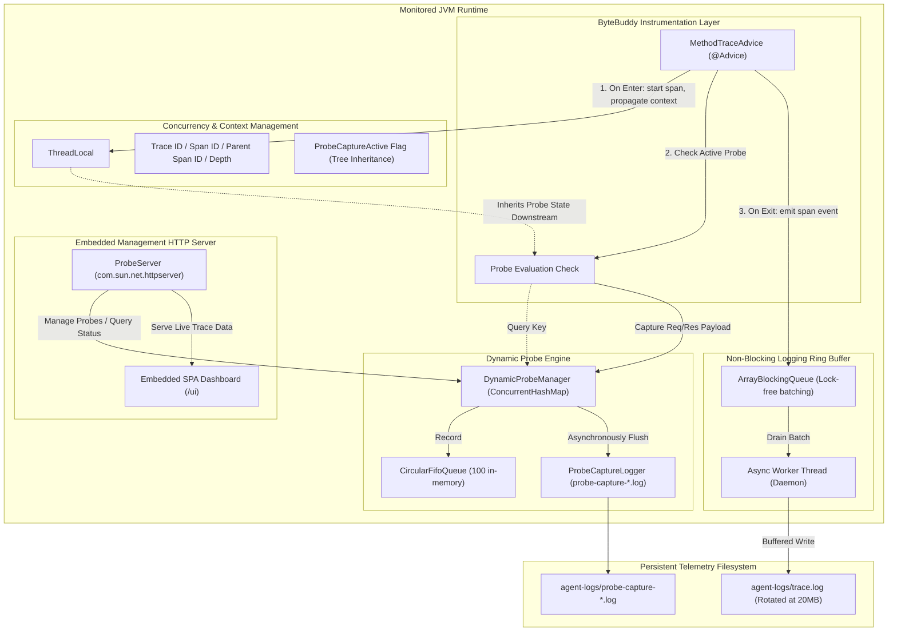

# Java Agent Architecture & Internals

This document details the architectural design, concurrency model, telemetry pipeline, and runtime instrumentation mechanics of the Enterprise Java Tracing Agent.

---

## High-Level Architecture



---

## 1. Zero-Overhead Instrumentation Principle

### ByteBuddy Inlining
The agent utilizes ByteBuddy's `@Advice` model. Unlike dynamic proxies or standard reflection interceptors, ByteBuddy `@Advice` directly **inlines bytecode** into the beginning (`@Advice.OnMethodEnter`) and end (`@Advice.OnMethodExit`) of targeted methods during class loading.
- No synthetic delegate classes are created.
- Stack frames are preserved identically.
- JIT compiler can inline hot path trace calls just like ordinary application code.

### Safe Exception Isolation
Trace advice is wrapped in `try-catch (Throwable ignored)` guarantees inside the inlined bytecode:
Under no circumstances will a tracing failure, queue saturation, or serialization error affect host application execution or throw an unhandled exception into business logic.

---

## 2. Distributed Tracing & Subtree Tree Inheritance

### Distributed Context Propagation
- Every request entering the system generates or inherits a unique `traceId` (UUID v4) and `spanId`.
- Each nested method invocation receives the current `spanId` as its `parentSpanId`, incrementing the `depth` counter.
- When an execution branch finishes, the context unwinds safely, maintaining exact hierarchical parent-child relationships for call tree reconstruction.

### REST & SOAP Downstream Subtree Inheritance
When troubleshooting a slow transaction, capturing arguments only at the controller layer is rarely enough. Developers need the payload flowing into internal services, database repositories, and downstream integration clients.

1. A probe is registered on a root service (e.g. `OrderService#processOrder` or a SOAP `@WebService` endpoint).
2. When the method enter advice triggers, `DynamicProbeManager` matches the probe and flags `TraceContext.setProbeCaptureActive(true)`.
3. As the execution thread calls subsequent internal methods (e.g. `PaymentGateway#charge`, `InventoryService#reserveStock`, `TaxClient#calculate`), each child invocation checks `TraceContext.isProbeCaptureActive()`.
4. Because the flag lives in the active `TraceContext` on `ThreadLocal`, **all downstream methods automatically capture their parameters and return values** without needing individual probes.
5. Once the root method exits, the flag is automatically reset to `false`.

---

## 3. High-Throughput Async Logging Pipeline

```
Application Thread              ArrayBlockingQueue               Worker Thread
       │                                │                              │
       ├── offer(TraceEvent) ──────────►│                              │
       │   (Drops if full to prevent    │                              │
       │    application blocking)       │                              │
       │                                ├── poll(500 items / 1s) ─────►│
       │                                │                              │
                                                                       ├── Buffered File Write
                                                                       └── Size-based Log Rotation
```

- **Ring Buffer**: Pre-allocated `ArrayBlockingQueue` (default: 20,000 capacity).
- **Non-Blocking Guarantee**: The advice uses `queue.offer()` rather than `queue.put()`. If the buffer fills up under extreme traffic spikes, events are safely dropped rather than degrading application latency.
- **Batch Flushing**: A single dedicated daemon thread drains up to 500 events in batch or flushes at 1,000ms intervals, minimizing system call and I/O context switch overhead.
- **Size-Based Log Rotation**: Output files rotate automatically upon reaching `maxFileSizeBytes` (default: 20MB) keeping `maxBackupFiles` retention.

---

## 4. Multi-JVM Isolation

In containerized, Kubernetes, or multi-instance deployments where multiple JVMs run concurrently:
- Each JVM can be assigned a distinct `jvmId` via configuration (`agent-config.json`) or command line (`-Dagent.jvmId=billing-pod-2`).
- The agent dynamically binds its probe log file to `probe-capture-<jvmId>-<timestamp>.log` or falls back to `probe-capture-<PID>-<timestamp>.log`.
- Host system details (Hostname, IP, OS, Total/Free Memory, Thread Count, Java Version) are captured and stamped in telemetry headers.
